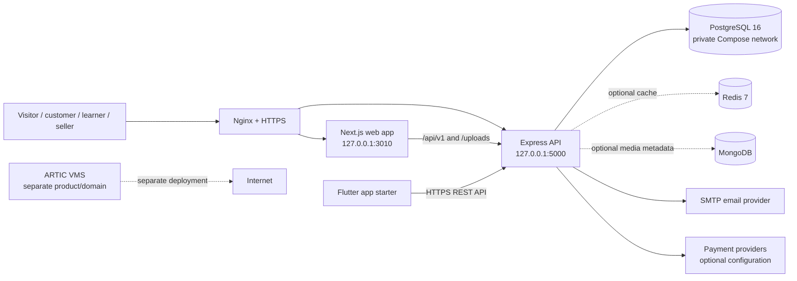

# ARTIC HUB — Current System Structure

**Company:** ARTIC Group Ltd  
**Product:** ARTIC HUB  
**Repository:** `Byiringiro24/Final_Artic_Market_Place`  
**Primary domain:** `https://artichub.ddnsgeek.com`  
**Reviewed:** 4 November 2026  

This document describes the implementation in the repository and the production state shown in the latest VPS output. A listed service is not necessarily a complete or live product; the status column distinguishes working application areas from partial and planned work.

## 1. System overview

ARTIC HUB is a modular monolith in one repository. The Next.js website and Express API are separate deployable processes, but the API modules share one codebase, one PostgreSQL database, and one versioned REST API. The web and Flutter clients call the API; neither connects directly to the database.



The diagram shows the intended deployment boundaries. The latest server log confirms Nginx, the Next.js frontend, PostgreSQL, and Redis were up. The API container repeatedly exited because Stripe was initialized with a blank key. The Stripe initialization is now lazy in the source so that optional Stripe configuration will not prevent other API features from starting; this correction still needs to be deployed to the VPS.

## 2. Repository layout

```text
Final_Artic_Market_Place/
├── frontend/                 Next.js App Router web application
│   ├── app/[locale]/         Localized public, account, checkout, and admin routes
│   ├── components/           Shared layout, marketplace, service, and homepage UI
│   ├── hooks/                Client hooks
│   ├── lib/                  API client, auth, routing, formatting, and config
│   ├── messages/             English, French, Kinyarwanda, Swahili, Arabic
│   ├── store/                Zustand auth, cart, currency, and UI state
│   └── public/               Images, logo, and static assets
├── backend/
│   ├── src/server.ts         Express middleware and API route composition
│   ├── src/routes/           Resource and feature endpoints
│   ├── src/controllers/      Marketplace/auth business logic
│   ├── src/middleware/       Authentication, authorization, rate limits, errors
│   ├── src/lib/              Email, payments, API response, logging, scheduling
│   ├── prisma/schema.prisma  PostgreSQL models and enums
│   └── prisma/migrations/    Versioned schema migrations
├── mobile/artic_app/         Flutter service-hub and Academy starter
├── deploy/vps/               VPS-only Docker Compose, environment helper, Nginx site
├── Docs/                      Product, deployment, and implementation documentation
├── docker-compose.yml         Legacy/development Compose file; not for this VPS
└── deploy.sh                  Deploys the isolated ARTIC HUB Compose project
```

The root `docker-compose.yml` is not the production deployment definition for the Contabo VPS. Use `deploy/vps/docker-compose.yml`; it keeps the ARTIC HUB Postgres and Redis private and binds the web/API host ports to loopback.

## 3. Application architecture

### Web frontend

- Next.js 15 App Router, React 19, TypeScript, Tailwind CSS, Radix-based UI.
- Localized routes use `next-intl` (`en-US`, `fr`, `rw`, `sw`, `ar`).
- TanStack Query manages API-backed server state; Zustand stores client auth/cart state.
- React Hook Form and Zod are used for forms and validation.
- Shared `Header` contains the global ARTIC HUB search. Search suggestions use `GET /api/v1/discovery/search`; `/[locale]/discover` groups results into Products, Services, Courses, and Pages. Marketplace-specific browsing remains at `/[locale]/search`.
- The home page is an ARTIC Group service directory and introduction, not the product catalog. It links to the marketplace, Academy, services, and separate VMS product.
- The admin UI is under `/[locale]/admin` and uses the same API with role-protected endpoints.

### Backend API

- Node.js 24 Alpine image in the current VPS Dockerfile; Express 4 and TypeScript.
- Public API prefix: `/api/v1`.
- PostgreSQL access is through Prisma. The production container applies `prisma migrate deploy` before starting the API.
- Redis is a private Compose service. The server currently treats Redis as optional at startup.
- MongoDB connection for media metadata is optional and non-fatal.
- Security and operations include Helmet, credentialed CORS, rate limiting, JWT access/refresh tokens, role checks, Zod validation in selected routes, Winston logging, and OpenAPI docs at `/api/docs`.
- Uploaded files are served from `/uploads`; Docker stores them in a persistent named volume.

### Data layer

The Prisma schema has these primary model groups:

| Area | Models |
|---|---|
| Identity and access | `User`, `RefreshToken`, `PasswordResetToken`, `EmailVerifyToken`, `Address` |
| Marketplace catalog | `Category`, `Brand`, `Product`, `ProductVariant`, `Review`, `BrowsingHistory` |
| Customer commerce | `CartItem`, `WishlistItem`, `Order`, `OrderItem`, `OrderStatusHistory`, `Promotion`, `ShippingZone`, `ShippingRate`, `TaxRule` |
| Content and operations | `Banner`, `WebPage`, `Setting`, `Notification`, `EmailLog`, `ContactInfo` |
| Services and sellers | `Service`, `SellerApplication` |
| Academy | `Course`, `CourseModule`, `Lesson`, `Enrollment`, `TrainingRegistration` |

The schema contains an `Enrollment.progressPercent` field, but current route implementations do not yet provide a learner enrollment/progress workflow. A schema field alone does not make that workflow available.

## 4. API areas currently mounted

All routes below are mounted by `backend/src/server.ts` beneath `/api/v1`.

| API area | Route module | Current scope |
|---|---|---|
| Authentication and users | `auth`, `users` | Registration/login, token flows, profiles, addresses, account data |
| Marketplace | `products`, `categories`, `brands`, `cart`, `wishlist`, `reviews`, `orders`, `promotions`, `shipping`, `taxes`, `currency` | Product discovery, cart/checkout/order operations, reviews, shipping/tax configuration |
| Content and settings | `banners`, `pages`, `settings`, `notifications`, `upload` | Homepage/CMS content, configuration, alerts, and media uploads |
| Admin | `admin` plus admin routes in feature modules | Dashboard and administrative operations for implemented areas |
| Seller onboarding | `sellers` | Seller application and review flows; not a complete seller operations/payout portal |
| Service catalog and bookings | `services`, `bookings` | Public active service listings/details and booking requests |
| Academy and training | `academy` | Published course catalog/detail, public training registration, admin course metadata CRUD |
| Global search | `discovery` | Search live published products, active services, and published courses |
| Ideas and contact | `ideas`, `contact` | Idea submissions and customer contact flows |
| Payments and callbacks | `payments`, `webhooks` | Stripe intent/webhook flows; availability depends on provider configuration |

## 5. Feature readiness

| Product area | Current implementation | Remaining work / qualification | Status |
|---|---|---|---|
| Marketplace catalog | Product/category/brand APIs, catalog search/filter page, product details, admin product management | Production availability depends on the API starting and product records being present in the HUB database | Implemented; current VPS API was unhealthy |
| Cart and checkout | Cart, orders, payment proof workflow, MTN MoMo instructions, cash-on-delivery path, Stripe flow in code | Verify each enabled payment method, payment status transitions, refunds/returns and shipping in production. PayPal is not integrated in the current payment routes | Partial; provider configuration required |
| Global discovery | Shared-header search and `/discover` page query products, services, and courses; destination cards link to existing hub pages and ARTIC VMS | Jobs/events/directory/subscriptions are not searchable as data modules because they are not implemented | Implemented for live records |
| Services | Admin-managed active services, public service cards/details, booking request endpoint | Booking records are currently represented by a notification rather than a dedicated booking table/calendar; provider scheduling and rescheduling are absent | Partial |
| ARTIC Academy | Published catalog/detail API, course metadata administration, training-interest registration | No learner enrollment endpoints, lesson player, lesson completion records, quizzes/assessments, certificate issue/verification, or course authoring UI for modules/lessons | Early/partial |
| Training operations | Public individual/team registration and WhatsApp opt-in field | Registration admin queue, approvals, reminders, attendance, exports, and consent-based community invitation need completion | Partial |
| Seller portal | Seller application and admin application review | Seller listing/order management, commissions, payout ledger, and performance portal need completion | Partial |
| Customer support | Contact/customer-service pages and message flow | Full ticket lifecycle, response SLAs, and case history are not complete | Partial |
| Jobs, directory, events, digital products, memberships | Portfolio descriptions and navigation/discovery concepts | No production data models and end-to-end workflows yet | Planned |
| Hotel/property systems | Portfolio concepts | Separate operational applications and role/data boundaries required | Planned/separate product |
| Health companion/agricultural IoT | Portfolio concepts | Product/device, partner, consent, validation, and support workflows required | Separate product concepts |
| ARTIC VMS | Separate application at `https://articvms.ddnsgeek.com` | Own host, authentication, database, ports, and deployment; not part of the HUB database | Separate product |
| Mobile app | Flutter starter with service hub/Academy catalogue direction | Android/iOS runner generation, authentication, shopping/checkout, bookings, push, and offline learning are not complete | Starter only |

The home page includes the full service portfolio, with live/partial/planned/separate-product distinctions. A portfolio card is descriptive; it does not imply that the associated workflow is production-ready.

## 6. Runtime and deployment topology

Production target on the Contabo VPS:

```text
artichub.ddnsgeek.com → Nginx :443 / TLS certificate
  /api/* and /uploads/* → 127.0.0.1:5000 → ARTIC HUB Express API
  all other paths       → 127.0.0.1:3010 → ARTIC HUB Next.js frontend

ARTIC HUB Compose project: artic-hub
  backend/frontend       published only on VPS loopback
  Postgres/Redis         private Docker network; no public host port
  persistent volumes    database, Redis, uploads, logs

articvms.ddnsgeek.com → existing, separate ARTIC VMS Nginx and Compose project
```

Protected VPS configuration is kept in `.env`, `backend/.env.production.local`, and `frontend/.env.production.local`. These files must not be committed or included in this document. `deploy/vps/configure-env.sh` fills generated secrets and prompts for optional provider configuration; `deploy.sh` validates Compose, builds/starts only `artic-hub`, and checks API health.

### Latest observed VPS state

Based on the owner-provided terminal output dated 4 November 2026:

- The VPS pulled commit `a30bc2d` from GitHub `main`.
- Nginx syntax check passed and HTTPS returned a frontend locale redirect (`307` to `/en-US`).
- ARTIC HUB Postgres and Redis containers were healthy.
- Prisma found three migrations and reported no pending migrations.
- Both web and API images built; the frontend container started.
- The backend exited during module initialization with `Neither apiKey nor config.authenticator provided` at the Stripe SDK constructor. The Stripe environment entries were left blank when the setup helper offered to disable Stripe.
- Therefore the API health check failed and marketplace/Academy API requests could not work. The production state has not been rechecked after the source fix in this branch.

The API startup failure was caused by eagerly creating Stripe with an empty API key. The current source now creates the Stripe client only when a Stripe operation is requested, returns a service-unavailable response for unconfigured Stripe operations, and omits the Stripe checkout option when the public Stripe key is blank. Deploy this source fix to restore the API with Stripe disabled; card checkout will stay unavailable until valid Stripe keys are configured.

## 7. Current build and deployment sequence

From the repository root:

```bash
cd /opt/artic-hub
git pull --ff-only origin main
bash deploy/vps/configure-env.sh
bash ./deploy.sh
sudo nginx -t && sudo systemctl reload nginx
curl -fsS http://127.0.0.1:5000/health
curl -I https://artichub.ddnsgeek.com
```

If the API health check fails, inspect its logs before retrying:

```bash
docker compose --env-file .env --project-name artic-hub \
  --file deploy/vps/docker-compose.yml logs --tail=120 backend
```

Do not run `docker compose down -v`, remove Docker volumes, seed demo data into production, or use the root legacy `docker-compose.yml` on the shared VPS. Back up the HUB database before migrations that change its schema.

## 8. Important source-of-truth notes

- This document describes the checked-out source as reviewed on 4 November 2026 and the owner-provided VPS logs. It is not an independent live-server health check.
- `README.md` contains older Marketplace-era feature claims, demo credentials, and setup assumptions. Verify it against current code before using it as an operational guide; never use example credentials in production.
- `Docs/ARTIC_HUB_VPS_Deployment_Status_and_Runbook.md` and `Docs/ARTIC_HUB_Status_Services_and_Academy_Curriculum.md` contain useful prior analysis; update their snapshots as deployment changes.
- The Flutter project is a starter, not a released mobile application.
- Vercel configuration is not the current VPS deployment path. The active VPS deployment uses Nginx and Docker Compose.
