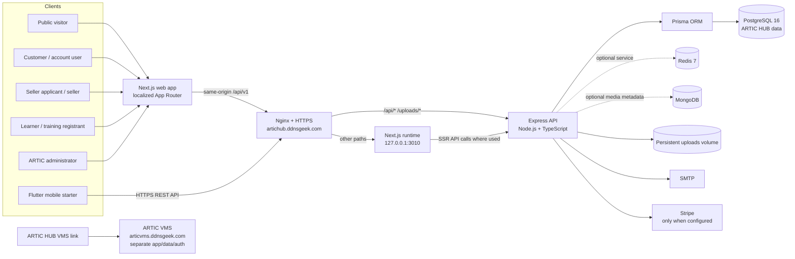
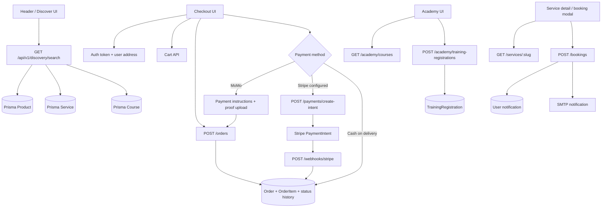

# ARTIC HUB — Full System Architecture, Users, APIs, and Workflows

**Company:** ARTIC Group Ltd  
**Product:** ARTIC HUB  
**Primary web domain:** `https://artichub.ddnsgeek.com`  
**Repository:** `Byiringiro24/Final_Artic_Market_Place`  
**Source reviewed:** commit `3070eb5` and the current repository  
**Prepared:** 4 November 2026  

This document describes how the current system is structured, how users and components interact, and which workflows are working, partial, or planned. It separates the codebase architecture from production health: the latest VPS logs supplied before this document showed the API failing during Stripe initialization. A fix was pushed in `3070eb5`; production must pull that commit and pass health checks before it is considered restored.

For the business service list and proposed deliverables, see [ARTIC HUB Full Service and Product Catalog](./ARTIC_HUB_Full_Service_and_Product_Catalog.md). For the shorter department map, see [ARTIC HUB Departments and Service Catalog](./ARTIC_HUB_Departments_and_Service_Catalog.md).

## 1. Executive overview

ARTIC HUB is a shared digital platform for ARTIC Group Ltd. The current architecture is a **modular monolith**:

- One Next.js web application serves public, customer, seller-application, Academy, and admin pages.
- One Node.js/Express API exposes feature modules under `/api/v1`.
- One PostgreSQL database stores marketplace, account, service, seller-application, CMS, and Academy records.
- Shared services include media uploads, email, notifications, rate limiting, payment integrations, and administration.
- A Flutter mobile starter is intended to use the same versioned API; it is not a complete mobile product yet.
- ARTIC VMS is a separate product with its own domain and authentication. ARTIC HUB currently links to it; this is not single sign-on or a shared database.

The platform can grow to cover the full ARTIC service portfolio without creating a separate frontend/backend/database for every department. Specialized products with separate risks or operational needs can later have their own service boundary while integrating through documented APIs.

## 2. High-level architecture



### VPS port and proxy map

| Public/host path | Nginx destination | Purpose |
|---|---|---|
| `https://artichub.ddnsgeek.com/` | `127.0.0.1:3010` | Next.js pages and static frontend assets |
| `https://artichub.ddnsgeek.com/api/*` | `127.0.0.1:5000` | Express REST API and webhooks |
| `https://artichub.ddnsgeek.com/uploads/*` | `127.0.0.1:5000` | API-served uploads and payment-proof images |
| `https://artichub.ddnsgeek.com/health` | API health handler on `127.0.0.1:5000` | API process health |

The VPS Compose project is named `artic-hub`. Its database and Redis are private to the Compose network and are not published on public host ports. Persistent volumes hold database, Redis, uploads, and logs. ARTIC VMS uses its separate existing Compose project and Nginx site.

## 3. Repository structure

```text
Final_Artic_Market_Place/
├── frontend/
│   ├── app/
│   │   ├── [locale]/(home)/       ARTIC Group landing page
│   │   ├── [locale]/(root)/       Marketplace, services, Academy, account pages
│   │   ├── [locale]/(auth)/       Sign-in, sign-up, verification, reset flows
│   │   ├── [locale]/admin/        ARTIC admin console
│   │   ├── [locale]/checkout/     Checkout and card-payment pages
│   │   └── api/auth/              NextAuth route integration
│   ├── components/                Shared layouts and feature UI
│   ├── hooks/                     Client hooks
│   ├── lib/                       Axios client, URL/config and formatting helpers
│   ├── messages/                  Localized interface messages
│   └── store/                     Zustand client state (cart/auth/currency)
├── backend/
│   ├── src/server.ts              Middleware, health check, and API mounts
│   ├── src/routes/                REST endpoints by feature
│   ├── src/controllers/           Marketplace/auth operations
│   ├── src/middleware/            Auth, role checks, validation, rate limits, errors
│   ├── src/lib/                   Email, Stripe, logging, scheduler, responses
│   └── prisma/                    Schema and migration history
├── mobile/artic_app/              Flutter starter, shared API direction
├── deploy/vps/                    VPS Compose, Nginx template, env setup helper
├── Docs/                          Architecture, service, Academy, and deployment docs
├── docker-compose.yml             Legacy/development Compose definition
└── deploy.sh                      Isolated ARTIC HUB VPS deployment helper
```

Use `deploy/vps/docker-compose.yml` for the shared Contabo host. The root `docker-compose.yml` is not the production VPS topology.

## 4. User types and access model

The current role enum is `USER`, `SELLER`, and `ADMIN`. Visitors are unauthenticated and are not stored as an account role. “Learner,” “employer,” “provider,” and “organization” describe user journeys, not implemented database roles unless a feature explicitly adds them.

| User type | Current identity/access | Current actions | Limits/current gaps |
|---|---|---|---|
| **Visitor** | No login required for public pages and selected public APIs | Explore landing page, products, categories, services, public courses, global search, contact, idea submission, training registration | Cannot use account-only cart/order/booking and account features |
| **Customer (`USER`)** | Registration/login; access token on API requests; refresh flow uses credentials/cookie support | Maintain profile/addresses, cart, wishlist, place/view orders, submit MoMo proof, request cancellation/return, post reviews, manage notifications, submit service booking | Organization purchasing/roles and full customer support ticket lifecycle are not implemented |
| **Seller applicant** | Authenticated `USER` submits seller application | Apply, inspect own application status, update/reapply after rejection | Application is not a complete seller portal; no API for seller product listing or payout management was found in current routes |
| **Approved seller (`SELLER`)** | Admin approval changes account role to `SELLER` | Can use the account with seller role | Seller-specific catalog ownership, fulfillment, commissions, settlement, and analytics are not complete in current routes |
| **Learner / training registrant** | Course browsing and public registration are available; registration is a record, not a full learner account lifecycle | Browse published course information; register interest in a course/team; opt into WhatsApp follow-up | No implemented enrollment API, lesson player, lesson completion tracking, quizzes, certificates, or learner dashboard |
| **Service customer** | Booking endpoint requires a logged-in account | Request a service booking with requested date/time and details | Booking is currently represented by a notification, not a dedicated booking record/calendar with update/cancel lifecycle |
| **ARTIC administrator (`ADMIN`)** | Authenticated admin role; protected by backend authorization middleware | Manage users, products, orders, categories, services, sellers, courses, settings, content, promotions, shipping, reviews, and reports where feature routes/UI exist | Some workflows have backend endpoints but no complete admin UI; Academy modules/lessons and training review queue remain missing |
| **VMS user** | Separate ARTIC VMS account and sign-in at the VMS domain | Register personal/company account and use VMS product | No shared ARTIC HUB token, SSO, account synchronization, or shared database connection is currently implemented |

### Authentication flow

1. The web application sends registration/login requests to `/api/v1/auth/*`.
2. The API validates credentials and returns an access token; refresh-token behavior uses the API’s cookie/refresh endpoint.
3. The shared Axios client sends `Authorization: Bearer <accessToken>` when a token exists and sets `withCredentials` for cookie requests.
4. Protected backend routes call `authenticate`; role-specific routes also call `authorize('ADMIN')` or another role check.
5. On a `401`, the Axios response interceptor attempts `/auth/refresh-token`, updates the access token, and retries the failed request. If refresh fails, it clears the stored access token and redirects to sign-in.

The exact token secrets and cookie values belong only in protected server configuration and are never included here.

## 5. Frontend-to-API connection model

### Browser requests

- The shared frontend API client is `frontend/lib/api.ts`.
- Production API base path is configured as `/api/v1`, so a browser request remains on the ARTIC HUB domain.
- Nginx forwards `/api/*` to Express on `127.0.0.1:5000`.
- Local development defaults to the API at `http://localhost:5000/api/v1`.
- The client sends JSON, credentials/cookies, and the bearer token where one exists. `ApiResponse` standardizes most successful API responses as `{ success, message, data }`.

### Server-rendered Next.js requests

`frontend/lib/backend-url.ts` provides a server-only URL resolver for internal API requests. The VPS Compose file sets an internal backend URL for Next.js. Use this binding/helper for server-side calls where the code actually invokes it; browser requests still use the public same-origin API path.

### API security/middleware order

The Express server applies Helmet, credentialed CORS for the configured frontend origin, static upload routes, raw-body Stripe webhook routing, JSON/form parsing, cookies, compression, request logging, and API rate limiting before mounting `/api/v1` routes. It then registers Swagger, `/health`, 404 handling, and the error handler.

Stripe webhooks receive raw request bytes for signature verification. Stripe is now constructed lazily. If Stripe is not configured, the API should still start and non-Stripe marketplace/API features should remain available; Stripe payment operations return an unavailable response.

## 6. API inventory and connections

All resource routes below are mounted beneath `/api/v1` by `backend/src/server.ts`. Authentication requirements can differ by endpoint within a resource; public listing and protected administration often share a router.

| API prefix | Main responsibility | Typical caller/workflow | Access pattern |
|---|---|---|---|
| `/auth` | Register, login, Google login, logout, refresh, email verify, forgot/reset password, current user, preferences | Auth pages and Axios refresh interceptor | Public auth routes; current-user/password/preferences protected |
| `/users` | Profile and address book | Account and checkout | Authenticated user owns own profile/address records |
| `/products` | Product catalog, featured/detail/related products, admin CRUD, browsing history | Homepage/marketplace/product detail/admin | Public/optional auth for catalog; admin for CRUD; signed-in user for personal history |
| `/categories`, `/brands` | Browse and administer catalog classification | Marketplace navigation and admin catalog screens | Public listing; admin mutations |
| `/discovery/search` | Cross-system product/service/course text search | Shared header and `/discover` results page | Public; returns only published/active records |
| `/cart`, `/wishlist` | User cart and saved products | Header/cart/checkout/account | Authenticated user-scoped data |
| `/orders` | Create/list/detail/cancel/return orders, payment proof, admin order operations | Checkout, customer order pages, admin order console | Customer owns own orders; admin routes use role authorization |
| `/payments` | Create Stripe payment intent; inspect payment state | Stripe checkout and order UI | Authenticated, order ownership checked; Stripe requires valid provider keys |
| `/webhooks/stripe` | Verify provider callback and reconcile payment/order state | Stripe platform callback | Public callback guarded by Stripe signature; raw request body required |
| `/reviews` | Product review create/read/moderation | Product detail and admin moderation | Public product reviews; signed-in review creation; admin moderation |
| `/promotions` | Coupon validation and admin promotion CRUD | Checkout and admin promotion page | Validation requires user; administration is admin-only |
| `/shipping`, `/taxes`, `/currency` | Shipping zones/rates, tax rules, currency rates/admin overrides | Checkout and admin configuration | Public read for applicable data; admin mutations |
| `/services` | Public active service listing/detail and admin CRUD | Services directory/details/admin | Public reads; admin management |
| `/bookings` | Create a service request and send notifications/email | Service booking modal | Authenticated user; current persistence is notification-based |
| `/sellers` | Apply, view own application, admin list/status review | Sell page and admin seller page | Application is authenticated; review is admin-only |
| `/academy` | Published course listing/detail, training registrations, admin course metadata | Academy pages and training form | Public catalog/registration; course metadata admin endpoints protected |
| `/ideas` | Validate public idea submission and email admins | Homepage idea form | Public, strict rate limit and honeypot; sends email, not a durable idea database record |
| `/contact` | Read/update business contact information | Footer/contact pages and admin | Public read; admin update |
| `/banners`, `/pages` | Homepage banner and CMS page content | Landing/CMS and admin | Public reads; admin mutations |
| `/settings` | Public site settings and admin grouped settings | Shared site components/admin | Public root settings; admin-only grouped settings/mutations |
| `/notifications` | User notifications, mark read/delete, admin SSE stream | Header/notification center/admin live updates | Authenticated user scope; admin stream role check |
| `/upload` | Media uploads and access to uploaded media workflows | Admin product/service content, proof/content tools | Endpoint-specific authentication/validation; persistent upload volume |
| `/admin` | Dashboard stats, users, products, orders | Admin console | Admin-only through route middleware |
| `/health` | Process status/time/environment response | Nginx/deploy health check | No authentication; confirms process response, not every dependency or UI flow |

### Important endpoint map

All paths below are relative to `/api/v1`. A router may contain additional operations; this map lists the current source endpoints most relevant to user journeys and operations.

| Endpoint(s) | Access | Purpose |
|---|---|---|
| `POST /auth/register`, `POST /auth/login`, `POST /auth/google` | Public, auth rate-limited | Create account or start a session |
| `POST /auth/logout`, `POST /auth/refresh-token`, `POST /auth/verify-email`, `POST /auth/forgot-password`, `POST /auth/reset-password` | Mixed public/session flows | End/refresh a session, verify address, recover account |
| `GET /auth/me`, `PUT /auth/change-password`, `PATCH /auth/preferences` | Authenticated | Read/update current account and preferences |
| `GET /products`, `GET /products/featured`, `GET /products/:slug`, `GET /products/:slug/related` | Public or optional auth | Catalog, featured items, product details, related items |
| `POST /products`, `PUT /products/:id`, `DELETE /products/:id`, `GET /products/admin/all` | Admin | Product administration |
| `GET /categories`, `GET /categories/:slug`, `GET /brands` | Public | Catalog navigation and filters |
| `GET /cart`, `POST /cart`, `PUT /cart/:id`, `DELETE /cart/:id`, `DELETE /cart` | Authenticated | User cart operations |
| `GET /wishlist`, `POST /wishlist`, `DELETE /wishlist/:productId` | Authenticated | User saved-product list |
| `POST /orders`, `GET /orders/my-orders`, `GET /orders/:id`, `POST /orders/:id/cancel`, `POST /orders/:id/return` | Authenticated; owner/admin checks apply | Customer order lifecycle |
| `POST /orders/:id/payment-proof` | Authenticated, order ownership | Upload MoMo proof image |
| `GET /orders`, `PUT /orders/:id/status`, `PUT /orders/:id/mark-paid` | Admin | Review and operate orders |
| `POST /payments/create-intent`, `GET /payments/status/:orderId` | Authenticated, order ownership | Stripe intent and payment status |
| `POST /webhooks/stripe` | Provider callback with signature verification | Reconcile Stripe events |
| `GET /discovery/search?q=...` | Public | Search current published products, active services, and published courses |
| `GET /services`, `GET /services/:slug` | Public | Browse active service listings |
| `POST /bookings` | Authenticated | Submit a service booking request |
| `POST /sellers/apply`, `GET /sellers/my-application` | Authenticated | Seller application and own status |
| `GET /sellers`, `PUT /sellers/:id/status` | Admin | Review and change seller application status |
| `GET /academy/courses`, `GET /academy/courses/:slug` | Public | Published Academy catalog/detail with preview metadata |
| `POST /academy/training-registrations` | Public with validation/consent | Store training-interest registration |
| `GET/POST /academy/admin/courses`, `PATCH /academy/admin/courses/:id` | Admin | Manage course metadata; not module/lesson authoring |
| `POST /ideas` | Public, strict rate limit | Validate and email an idea to ARTIC administrators |
| `GET /contact`, `PUT /contact` | Public read / admin update | Business contact information |
| `GET /banners`, `GET /pages`, `GET /pages/:slug` | Public | Public site content |
| `GET /pages/admin/all`, `POST /pages`, `PUT /pages/:id`, `DELETE /pages/:id` | Admin | CMS management |
| `GET /notifications`, `PUT /notifications/:id/read`, `PUT /notifications/read-all`, `DELETE /notifications/:id` | Authenticated user scope | Notification inbox operations |
| `GET /notifications/stream` | Authenticated; admin stream is role-checked | Server-sent notification updates |
| `GET /shipping/zones`, `GET /taxes`, `GET /currency/rates` | Public read | Checkout configuration and display data |
| `POST/PUT/DELETE /shipping/zones*`, `POST/PUT/DELETE /taxes*`, admin currency endpoints | Admin | Configure rates and rules |
| `POST /upload/*` | Endpoint-specific auth and validation | Media upload operations |
| `GET /health` | Public | API process health response |

### API dependency chains



## 7. Data domains and ownership

### Main database groups

| Domain | Core records | Ownership/relationship |
|---|---|---|
| Identity | Users, refresh tokens, email verification/reset tokens, addresses | Tokens and addresses belong to one user; roles are account-wide |
| Catalog | Products, variants, categories, brands, reviews, browsing history | Product belongs to a category and optional brand; reviews relate product/user; history is user-scoped |
| Commerce | Cart items, wishlist, orders, order items, status history, promotions, shipping/tax | Cart/wishlist/order belong to customer; order items reference purchased product snapshots/records; admin updates status |
| Seller onboarding | Seller applications/status/admin notes | One application per user; approval changes the user role to `SELLER` |
| Services | Service catalog | Active listing is visible publicly; service has no persisted booking relation in the current schema |
| Academy | Courses, modules, lessons, enrollments, training registrations | Courses own modules/lessons; enrollments link user/course; registrations store applicant details and optional course link |
| Content and operations | Web pages, banners, contact info, settings, notifications, email logs | Admin-managed content/settings; notifications belong to user; contact entries are shared |

### Important persistence distinctions

- Service bookings are currently saved as a notification, not as a dedicated booking table with a complete lifecycle.
- Idea submissions are validated and emailed to admin users; the route does not persist an idea record in the current schema.
- Academy training registrations are durable records. They do **not** enroll a user in a course or unlock private lesson content.
- The schema includes `Enrollment.progressPercent`; current API routes do not expose the learner enrollment/progress workflow.
- Stripe payment confirmations update an order through a signed webhook. Do not mark a Stripe order paid based only on a browser redirect.
- ARTIC VMS accounts and records are held by the separate VMS system.

## 8. End-to-end working flows and scenarios

### Scenario A — Visitor explores the ARTIC ecosystem

1. Visitor opens the locale-aware homepage, e.g. `/{locale}`.
2. Homepage introduces ARTIC Group Ltd, departments, current service portfolio, idea/contact routes, Academy, marketplace, and VMS link.
3. Visitor enters a query in the shared search bar.
4. The search dropdown calls `GET /api/v1/discovery/search?q=...` and labels results as Product, Service, or Academy course with their location.
5. Search submission opens `/{locale}/discover?q=...`, where the user filters Products, Services, Courses, and ARTIC HUB pages.
6. Product/service records open their detail routes. Course results open course-specific training registration. VMS navigation opens the separate VMS domain.

**Current boundary:** Directory/jobs/events/membership results are not returned as live listings because those record systems are planned rather than implemented.

### Scenario B — Customer browses and buys a marketplace product

1. Customer browses the localized marketplace at `/{locale}/search`, category pages, or global discovery.
2. Product list/detail calls the product API; public product detail can optionally use auth for personalization.
3. Customer signs in. The API auth flow supplies an access token and refresh mechanism.
4. Customer adds items to the server-side cart; cart API associates records with the authenticated user.
5. Checkout loads the user’s saved addresses and lets the customer choose an enabled payment method.
6. The frontend posts the order to `POST /api/v1/orders`; backend validates the request and stores an order, items, totals/status, and relevant snapshot data.
7. The next step depends on payment choice:
   - **MTN MoMo:** The page displays payment instructions; the customer uploads proof to `POST /orders/:id/payment-proof`. The backend validates the image, converts it to WebP, stores it in the persistent uploads volume, and links the proof to the order. Admin reviews/marks payment.
   - **Cash on delivery:** The order proceeds through order status operations; no Stripe call is required.
   - **Stripe:** Available only when both public and backend Stripe settings are configured. The API creates a PaymentIntent. Stripe calls `/webhooks/stripe`; verified events reconcile payment state with the order.
8. Customer follows order status in account pages; admin handles fulfillment/status updates and applicable returns/cancellation operations.

**Failure behavior:** If the API is down, catalog data, cart, checkout, login, and search results can fail even if Nginx and the Next.js homepage load. If Stripe is disabled, non-Stripe API startup should work after the `3070eb5` fix, and the checkout UI hides card payment when the publishable key is blank.

### Scenario C — Seller applies to join the marketplace

1. User signs into ARTIC HUB and opens `/{locale}/sell`.
2. Frontend posts business information to `POST /api/v1/sellers/apply`.
3. API creates or reopens the user’s seller application and sends admin notification email asynchronously.
4. User checks status through `GET /api/v1/sellers/my-application`.
5. Admin views applications and approves/rejects with `PUT /api/v1/sellers/:id/status`.
6. Approval updates the account role to `SELLER` and notifies the applicant.

**Current boundary:** The application and approval loop exist; seller-owned listing CRUD, fulfillment workspace, commission calculation, payout ledger, and seller reports do not yet complete the seller journey.

### Scenario D — Customer requests a professional service

1. Visitor views active services through `GET /api/v1/services` or `GET /services/:slug`.
2. Customer signs in and submits the booking modal.
3. API creates a user notification and sends email to ARTIC admins and the customer.
4. Customer receives an acknowledgement with requested date/time.

**Current limitation:** This is a booking request, not confirmed scheduling. The current API stores it as a notification and has no dedicated booking record, provider calendar, availability rules, cancellation, or rescheduling state.

### Scenario E — Learner discovers and requests training

1. Visitor browses the Academy page; frontend calls `GET /api/v1/academy/courses` for published courses.
2. The public course-detail API provides course metadata and preview lesson titles only.
3. Learner selects a course or requests general/team training.
4. Frontend posts name/contact/course/consent/optional WhatsApp opt-in to `POST /api/v1/academy/training-registrations`.
5. API validates the registration, verifies any selected course is published, and stores a `TrainingRegistration` record.

**Current limitation:** This does not create a login/enrollment, unlock lessons, record progress, grade assessments, or issue a certificate. Those functions must be built before describing ARTIC Academy as a complete e-learning system.

### Scenario F — Administrator manages catalog and operations

1. Admin signs in with an account carrying role `ADMIN`.
2. Admin UI calls feature endpoints such as `/admin/dashboard`, `/products/admin/all`, `/orders`, `/sellers`, `/services/admin/all`, `/academy/admin/courses`, and admin content/settings endpoints.
3. Express `authenticate` verifies the caller; `authorize('ADMIN')` gates protected routes.
4. Admin updates products, order states, seller applications, service records, promotions, site content, contact information, and configuration according to each implemented feature.
5. User notifications and emails communicate relevant state changes where implemented.

**Current limitation:** Some feature APIs exist without a full matching admin workbench. Training registrations do not yet have the complete approval queue/reminder/attendance tools; Academy modules/lessons are not yet authorable through an admin UI.

### Scenario G — Visitor submits a product/service idea

1. Visitor completes the homepage idea form with name, email, category, and a description.
2. `POST /api/v1/ideas` applies strict rate limiting, input validation, and a honeypot check.
3. API emails the idea to ARTIC administrators and returns success when email sending succeeds.

**Current limitation:** The idea is not currently stored in a durable idea pipeline, so there is no status tracking, triage board, or response history in ARTIC HUB.

### Scenario H — Payment provider callback

1. Customer requests a Stripe PaymentIntent for an eligible order.
2. The backend calls Stripe using the configured secret key.
3. Stripe sends a webhook to `/api/v1/webhooks/stripe`.
4. Express routes the webhook before general JSON parsing so Stripe can verify the exact request bytes and signature.
5. Verified payment events update the matching order transactionally and may create order status history/email.

If Stripe is not configured, API startup still proceeds under the current source fix; Stripe-specific operations return unavailable. The UI should only present the card option when the publishable key is configured.

### Scenario I — VMS user follows a link from ARTIC HUB

1. User chooses ARTIC VMS from the home page/service directory.
2. Browser opens `https://articvms.ddnsgeek.com` and the user registers or signs in within VMS.
3. VMS handles its own profile, company/personal account type, authentication, and vehicle workflows.

There is no current shared identity, token exchange, account provisioning, or API integration between VMS and ARTIC HUB.

## 9. Database and infrastructure boundaries

### Local development

- Frontend Next.js dev server usually runs at `http://localhost:3000`.
- Backend API listens at `http://localhost:5000/api/v1`.
- Root/development Compose has older settings and may publish ports directly; it is not the shared VPS production definition.

### VPS production

- Nginx terminates HTTPS for `artichub.ddnsgeek.com`.
- Frontend uses host loopback port `3010`; API uses host loopback port `5000`.
- PostgreSQL and Redis run privately in the `artic-hub` Compose network; their host ports are not exposed in the production Compose file.
- Separate named volumes retain database, Redis, uploads, and logs.
- ARTIC VMS uses a separate Compose project, existing host ports, Nginx site, and certificate.
- Deployment runs `prisma migrate deploy` in the backend container before starting the API.
- SMTP and provider credentials stay in protected server files. Do not commit or paste them into documentation.

### Optional integrations

| Integration | Current behavior |
|---|---|
| SMTP | Used for verification/reset, order, seller, booking, and idea notifications where the flow calls email; requires server configuration |
| Stripe | Lazy initialized in source commit `3070eb5`; card checkout requires valid secret, webhook secret, and publishable key |
| PayPal | Payment enum/config examples exist; current payment route implementation does not complete PayPal checkout |
| Redis | Included in VPS Compose; backend startup treats it as optional. Do not assume every feature is currently backed by Redis |
| MongoDB | Optional connection for media metadata; PostgreSQL remains the system-of-record for core application data |
| VMS | Separate product; current integration is outbound navigation only |

## 10. Reliability, security, and operational behavior

- **Health:** `/health` confirms the API process responds. It does not by itself verify every payment/email/optional service or frontend user journey.
- **Rate limiting:** Applied to `/api/`; auth has tighter route-specific limits, and ideas use a strict limiter.
- **Validation:** Order APIs use shared validation middleware; Academy uses Zod schemas; other routes vary. Continue adding explicit schemas and ownership checks to each mutation.
- **Authorization:** Authenticated identity is placed on the request by middleware; sensitive mutations should use role checks and user ownership checks.
- **Uploads:** Files are stored on persistent storage and exposed through `/uploads`. Payment proof accepts a limited image set, is size-limited, converted to WebP, and linked to the order.
- **Error responses:** Successful API operations generally use `{ success, message, data }`; known application errors use HTTP status and a message; unknown production errors are generalized.
- **Email failure:** Email is not a substitute for durable records. For operations that must be reviewed later, save the record first and use queued/retryable notifications.
- **Database changes:** Use versioned Prisma migrations and back up production data before schema changes. Do not run seed/demo scripts against production without a reviewed data plan.
- **Data protection:** User, address, order, seller-application, and training-registration fields are personal/business data. Limit access and define retention before building learner profiles, job applications, health, or biometric features.

## 11. Current readiness snapshot

| Area | Source status | Production status evidenced by latest user-provided logs |
|---|---|---|
| Homepage and localized web runtime | Built and routes render | Nginx/frontend responded; root redirected with HTTP 307 to `/en-US` |
| Marketplace UI/API | Core flows and routes exist | API container exited; marketplace API-dependent pages/actions were unavailable |
| PostgreSQL/migrations | Prisma schema/migrations in repository | PostgreSQL healthy; three migrations present and no pending migrations reported |
| Redis | Compose service available | Container healthy in supplied logs |
| Global discovery search | Added and included in source commit `a30bc2d` | User output shows that commit was pulled |
| Stripe startup fix | Included in source commit `3070eb5` | Not present in the supplied failing server logs; deploy this commit and recheck |
| Academy | Catalog + training registration partial | Backend outage prevented API confirmation; full learning workflows remain unbuilt |
| ARTIC VMS | Separate service | Its deployment is outside the HUB and should remain untouched by HUB deployment |

The latest evidence is based on user-provided terminal output, not a live independent check. After deploying `3070eb5`, confirm the container state, `/health`, public domain, and key user journeys.

## 12. Known gaps to build next

### Marketplace and operations

- Restore and verify the API on VPS after pulling the Stripe startup fix.
- Verify products/categories are present in the production HUB database and confirm import/backup provenance before changing data.
- Verify enabled checkout methods end-to-end; reconcile order lifecycle, payment proof, shipment, cancellation, returns, refunds, and notification failures.
- Complete seller-owned product listing, inventory, order fulfillment, commissions, payouts, and seller reports.
- Complete customer support case tracking and operational audit logs.

### Academy

- Registration review/approval queue and communication/attendance workflow.
- Admin course/module/lesson authoring and secure content storage.
- Enrollment and entitlement model connected to payment or approval.
- Learner dashboard and lesson player, preserving preview/private-content access rules.
- Progress records, quiz/assessment results, completion criteria, certificates, and verification page.
- Organization/team learner management and consent-based community invitation.

### Services and new divisions

- Dedicated booking records, availability, calendar, provider assignment, confirmation, cancellation, rescheduling, and reminders.
- Business directory/jobs/events/digital products/membership entities and end-to-end user workflows.
- Mobile platform runners and complete login, cart, booking, and learning experiences.
- Separate product boundaries and compliance/support models for health, hotel/property, agriculture/energy, and biometric use cases.

## 13. Suggested implementation and release sequence

1. Pull the latest source (`3070eb5`) on the VPS and rebuild the ARTIC HUB Compose project only.
2. Confirm backend logs no longer show Stripe constructor failure; verify API health and same-origin `/api/v1` routing.
3. Verify marketplace API and data, then test visitor, customer, admin, seller application, MoMo proof, COD, and optionally Stripe journeys.
4. Mark each payment method and service live only after its complete production workflow passes.
5. Finish durable bookings and service operations.
6. Build Academy enrollment/content/progress/assessment/certificate workflows.
7. Add adjacent directory/jobs/events/digital-download/membership systems after roles, data retention, payment entitlements, and moderation are defined.
8. Keep ARTIC VMS and future vertical products isolated, integrating only through reviewed APIs or explicit links.

## 14. Source-of-truth and update rules

- This document is based on the source tree and the last supplied VPS logs. Update the production table after every verified deploy.
- `README.md` contains historical Marketplace-era claims and demo/setup notes; do not use those as evidence of current production features or credentials.
- Do not put environment values, SMTP app passwords, JWT secrets, database URLs/passwords, OAuth secrets, or payment credentials in this document.
- When a workflow moves from Planned/Partial to Available, document the UI route, API endpoints, roles, database records, provider dependencies, operational owner, and production verification evidence.

